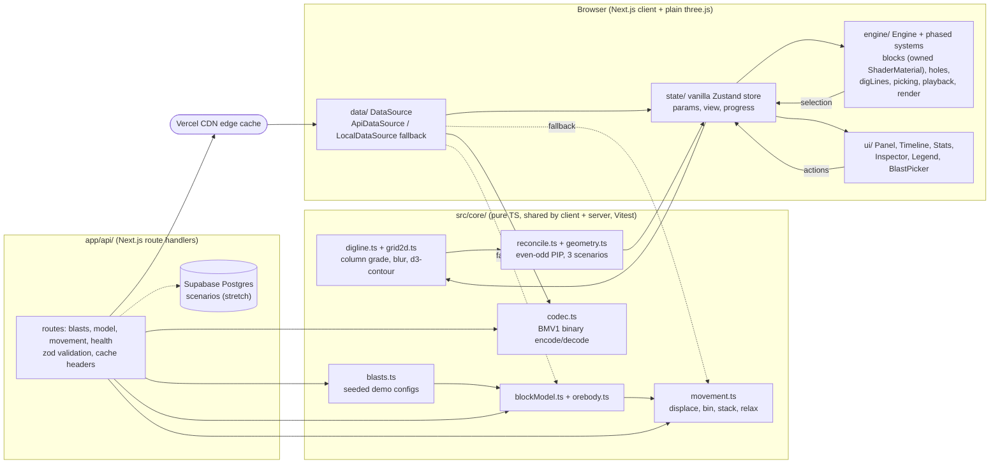

# 02 — Project Plan: Blast Movement Viewer (concept prototype)

> A concept prototype exploring blast movement visualisation: a synthetic block model, a **heuristic** (not physics) movement model served by a small API, and ore loss/dilution reconciliation against original and movement-adjusted dig lines.
> Target role: **Front End Engineer – 3D Visualisation** (Augment Technologies, Remote/WA). The posting's focus is interactive 3D visualisation of mining data, rendered performantly in the browser. Backend is "highly desirable" and agentic engineering is *required*.
> Build: **Sun 8 Nov 2026** (target v1.0 by ~21:00), with **Mon 9 Nov as overflow**. About 11 h of your time today; agents run in parallel. ⚠️ = assumption or uncertain. Domain background: [01-research.md](01-research.md). Stack and engine decisions: [03-engine-architecture.md](03-engine-architecture.md).

**Framing (use it everywhere: README, Loom, email):** *"This is the front end and API I'd build around a blast-movement engine. The movement model is a deliberately simple stand-in for the engine's output; the showcase is the visualisation, the interaction and the data plumbing."*

---

## 1. Requirements

### 1.1 User stories
| # | As a… | I want to… | So that… |
|---|---|---|---|
| U1 | grade-control geologist | see the bench block model coloured by grade, with the planned ore boundary | I understand the in-situ ore before the blast |
| U2 | geologist | fire the blast and scrub between before and after | I see where each part of the ore body went |
| U3 | geologist | see the original dig line over the muckpile | I can spot ore thrown outside it and waste thrown inside it |
| U4 | mine planner | compare ore loss, dilution, tonnes and grade for *original* vs *adjusted* dig lines | I can put a number on the value of adjusting for movement |
| U5 | geologist | colour blocks by outcome (ore→mill, ore lost, dilution, waste) | the cost of digging the old line is obvious at a glance |
| U6 | engineer | click a block and see its grade, tonnes, original → final position and displacement | I can check the model in detail |
| U7 | engineer | change throw, swell and randomness and get a new movement result | I can build intuition for how sensitive the outcome is |
| U8 | Augment reviewer | read clearly what is simplified and how it would scale | I can judge the engineering honestly |
| U9 | geologist | pick from several blasts (different ore bodies and sizes) | I see the tool works on more than one hand-tuned case |
| U10 | geologist | see the blastholes and their sampled grades with the block model | the scene shows the real inputs to grade control, not just voxels |
| U11 | front-end client (the app itself) | fetch block models and movement results from an API as compact binary | the app is built the way it would be against a real engine |

### 1.2 Scope tiers

**MVP = Checkpoint 1: live on Vercel by ~16:00 Sunday** (client-only is fine; the API arrives later the same day behind the same interface)
| ID | Feature | Acceptance criteria |
|---|---|---|
| M1 | Synthetic block model | Deterministic from a seed: same seed gives identical arrays. Default 40×24×4 blocks of 2.5 m (3,840 blocks, 100×60×10 m bench). A dipping ore lens plus noise gives about 15–30% ore by tonnes. Grade classes: waste < 0.5, low 0.5–1.5, high ≥ 1.5 g/t Au. Unit test: Σ tonnes = Σ volume × density. |
| M2 | Instanced 3D render | **One draw call** for all blocks (check `renderer.info.render.calls`). Grade colours with a legend. Orbit camera. ≥ 55 fps on a typical laptop in Chrome at 3,840 blocks. |
| M3 | Movement model | Pure function `computeMovement(model, params)`. Unit tests: (a) **no two blocks share a post-blast slot**, (b) **no floating blocks**, (c) tonnes and metal conserved exactly, (d) deterministic per seed, (e) mean horizontal displacement is larger in the top flitch than the bottom one, and larger at the front row than the back row. Runs in < 50 ms for 3,840 blocks. |
| M4 | Blast animation and scrubber | A "Blast" button animates 0→1 over about 2.5 s with front rows firing first. A slider scrubs in either direction. Per-frame CPU work = **one uniform update**. No popping at t = 0 or 1. |
| M5 | Original dig line | Contoured from the in-situ model with the same algorithm as M6. A bright outline that stays fixed in world space after the blast. |
| M6 | Adjusted dig line | Contoured from the post-blast model. A different colour and line style, toggleable. |
| M7 | Reconciliation stats | Three columns: **In-situ / original**, **Post-blast / original**, **Post-blast / adjusted**. Rows: mill t, mill grade, ore loss %, dilution %, Au to mill (oz), plus a delta row. Fixture tests match hand calculations. Formula tooltips. |
| M8 | Honesty and branding | Always-visible footer: "Concept prototype · heuristic movement model, not physics · synthetic data". Your name and links. No Augment name, logo, colours or product names. |
| M9 | Deployed | Public Vercel URL, public GitHub repo, README stub with screenshot. |
| M10 | `DataSource` boundary | All data access goes through `DataSource` (ADR-9). `LocalDataSource` (runs `core/` in the browser) ships at Checkpoint 1. Swapping to `ApiDataSource` changes no UI or engine code. |

**Polish: Sunday evening, then Monday overflow** (§5 says which items land today)
| ID | Feature | Notes |
|---|---|---|
| P1 | Colour modes: grade / outcome / movement distance | Outcome mode is the key visual. Movement mode uses a viridis ramp. |
| P2 | Click-to-inspect | Highlight the block (rewrite its `aColor`) plus an inspector card. CPU ray–AABB picking works at any point in the scrub (ADR-2). |
| P3 | Section/slice slider + "ore only" toggle | Shows ore pushed under waste. A `uSection` plane uniform + `discard` in the block shader. |
| P4 | Visual quality | Shader edge-darkening, hemisphere + directional lighting, optional baked per-block occlusion (`aOcclusion`), translucent dig-line curtain, unblasted context rock, plan-view camera button. No post-processing. |
| P5 | Blast parameter panel → **movement endpoint** | Debounced (~300 ms) `GET /api/blasts/:id/movement?...`. Animates to the new result. Falls back to local compute if the API fails. |
| P6 | Performance via the **dense demo blast** | `b1040-031` = 80×48×8 = 30,720 blocks served by the API. FPS overlay in dev. Replaces the old client-side "dense toggle". |
| P7 | README, About modal, Loom | See §7. |
| **P8** | **API** (ADR-10/11/12) | Next.js route handlers: `GET /api/blasts`, `GET /api/blasts/:id`, `GET /api/blasts/:id/model` (binary), `GET /api/blasts/:id/movement` (binary, CDN-cached), `GET /api/health`. Zod-validated. Codec round-trip and endpoint tests. Blast picker in the panel header. |
| **P9** | **Blasthole layer** | Instanced cylinders on the burden × spacing pattern, coloured by sampled grade. Visible before the blast, fading out during it. Labelled "illustrative pattern, not used by the movement heuristic". |

**Stretch, ranked by impact ÷ effort**
| Rank | Feature | Impact | Effort | Why |
|---|---|---|---|---|
| 1 | **Saved scenarios** (`POST/GET /api/scenarios`, Supabase Postgres) + share link `/s/:id` | High (full-stack) | 1–1.5 h | Persistence and sharing; uses your Supabase experience. Fallback: params in the URL hash (20 min, no DB). |
| 2 | Displacement vector layer (instanced arrows, subsampled) | Med | 1 h | Makes "vectors" literal |
| 3 | CSV/JSON export (`GET /api/blasts/:id/export?format=csv`) | Med | 0.5 h | Data literacy; a server endpoint is a natural fit |
| 4 | **Editable dig line** (drag vertices, live stats; saved in scenarios) | High | 2–3 h | The JD's "work with the models, not just view them" |
| 5 | Uncertainty: K seeds → per-cell ore probability map, P10/P50/P90 loss | High | 2 h | Echoes Hmoud & Kumral; strong interview material |
| 6 | **Real public block model scale demo** (e.g. MineLib ⚠️, check format/licence) at 0.1–2 M blocks with interior culling + Web Worker decode | High (to engineers) | 3 h+ | Proves the scaling claims on real geometry |
| 7 | Async job API (`POST /api/runs` → 202 + runId, poll/SSE) | Med | 1.5 h | How a real, slower engine would be integrated |
| 8 | Free-face choice / two free faces; per-flitch dig lines | Med | 1.5–2 h each | Domain-correct refinements |

---

## 2. Design decisions (ADR style)

### ADR-1: Next.js App Router + plain three.js (full reasoning: [03-engine-architecture.md](03-engine-architecture.md))
- **Options:**
  - (a) Vite + R3F + Hono
  - (b) **Next.js + plain three.js `WebGLRenderer`**
  - (c) `WebGPURenderer` + TSL (plain or in R3F)
- **Choice:** (b). It's your stack (Next 15 + three r176 last time), so there's no learning cost on a deadline. Under R3F the hot paths would be imperative three.js anyway. WebGPU/TSL would mean porting your GLSL (`ShaderMaterial`/`onBeforeCompile` aren't supported there), and the official docs still call it experimental ⚠️.
- **Engine:** your *SceneContext + system factories* pattern, adapted to fix the last project's pain points:
  - explicit phases and one ordered registry
  - `update({ dt, elapsed })` with clamped dt
  - mandatory `dispose()` + `DisposeBag`
  - one `SystemFactory` type
  - a shared vanilla Zustand store instead of DOM ids

  See 03 §2.
- **Next.js integration:** `page.tsx` stays a server component. A `'use client'` loader imports the viewer with `next/dynamic(…, { ssr: false })`, which keeps three.js out of SSR and the initial bundle. Turbopack (the Next 16 default for dev and build) needs no loader config because shaders are `.glsl.ts` modules.
- **Trade-off:** ~200 lines of engine glue and hand-written lighting. No drei: use `three/addons` OrbitControls and `Line2`/`LineMaterial`.
- **Guardrail:** React never re-renders per frame. The engine reads continuous values with `store.getState()` inside its loop.

### ADR-2: Rendering and per-instance animation
- **Options:**
  - `THREE.Points`: doesn't read as volume
  - InstancedMesh with **CPU matrix updates** per frame: O(N) JS plus upload every frame
  - stock material patched with `onBeforeCompile` for GPU interpolation: fragile string patching (your pain point #7)
  - **instanced geometry + owned `ShaderMaterial` with GPU interpolation**
- **Choice:** `InstancedBufferGeometry` (unit box) + `Mesh` + an **owned `ShaderMaterial`**. No `onBeforeCompile` patching (pain point #7) and no reliance on `instanceMatrix`/`instanceColor`.
  - **Attributes:** `aStart`, `aEnd` (vec3), `aDelay` (float), `aColor` (vec3), optional `aOcclusion` (vec2, pre/post).
  - **Uniforms:** `uProgress`, `uDur`, `uArc`, `uBlockSize` (vec3), `uScaleEnd` (= swell^⅓), `uSection`.
  - **Lighting:** about 15 lines (hemisphere + one directional + edge darkening).
  - **Colour mode change:** rewrites `aColor` once.
- **Vertex core** (`shaders/blocks.vert.glsl.ts`):
  ```glsl
  float t = clamp((uProgress - aDelay) / uDur, 0.0, 1.0);
  t = t * t * (3.0 - 2.0 * t);                      // smoothstep — same function exported from TS for picking
  vec3 p = mix(aStart, aEnd, t);
  p.z += uArc * 4.0 * t * (1.0 - t) * length(aEnd.xy - aStart.xy);  // throw arc (mine Z-up)
  vec3 worldPos = position * uBlockSize * mix(1.0, uScaleEnd, t) + p;
  gl_Position = projectionMatrix * viewMatrix * modelMatrix * vec4(worldPos, 1.0);
  ```
- **Why:** the scrubber costs one uniform per frame whatever N is, the same pattern as your forest wind shader. And because nothing is patched, three.js upgrades can't break it.
- **Consequences:**
  1. `mesh.frustumCulled = false`.
  2. **Picking:** CPU ray–AABB over positions interpolated with the shared TS easing. It works mid-scrub, about 1 ms at 30k blocks.
  3. Section view = `uSection` plane + `discard`.
  4. **No shadows in the MVP.** Displaced instances would need a matching `customDepthMaterial`.
- **Rejected:** rigid-body physics (Rapier). It's slow, non-deterministic and can't guarantee conservation, and it implies "physics", which overclaims.
- **Other layers:** blastholes (P9) and arrows (S2) are separate instanced meshes with stock materials, one draw call each. Holes fade out with an opacity uniform.

### ADR-3: Movement model (heuristic)
Coordinates are mine-grid metres: x = East, y = North, z = elevation. Bench local frame: **u** = distance from the free face along the throw direction (free face = east, throw = +x). **H** = bench height.

**Step 1: target plan displacement**
- s = u / U ∈ [0,1] (0 = front row), h = (z − z_toe)/H ∈ [0,1] (1 = crest)
- Throw: `T = T_max · [r_back + (1−r_back)(1−s)^p] · [r_toe + (1−r_toe)·h] · (1 + 0.25·R·n₁)`
- Lateral: `L = R·σ_lat·n₂ + fan·((y−y_c)/(W/2))·(1−s)`
- n₁, n₂ = seeded 3D simplex noise at centroid / ℓ (ℓ ≈ 8 m), so neighbours move coherently.
- Defaults: T_max = 10 m, r_back = 0.2, p = 1.5, r_toe = 0.4, σ_lat = 1 m, fan = 1 m, R = 0.5. This gives the top flitch ~6–10 m and the bottom ~3–4 m, in the Husab range ⚠️ (single site, used as a sanity check only).
- No explicit vertical term: vertical drop emerges from stacking.

**Step 2: swell + re-grid (prevents overlap)**
- k = swell^(1/3) (1.3 → 1.091). Post-blast plan grid with cell size c′ = c·k, covering the footprint plus T_max + margin.
- Bin each target (x+T, y+L). Clamp behind the back wall (u ≥ 0) and at the confined sides.

**Step 3: stacking (prevents floating)**
- In each cell, sort by original z ascending (ties: front first).
- `z_n = z_floor + (n + ½)·H_b·k`. Final x,y = cell centre.

**Step 4: angle-of-repose relaxation**
- Δ = tan(φ)·c′, φ = 37° ⚠️.
- Repeatedly move the top block of the tallest offending cell to its lowest valid neighbour, until stable or 20·N moves.

**Step 5: animation delay**
- `aDelay = 0.45·s + 0.05·noise`: front rows fire first. Visual only.

**Known simplifications (README):**
- no timing, explosive or rock physics
- vertical order preserved
- lattice-snapped, so no sub-block mixing
- one free face

### ADR-4: Muckpile surface and swell
- The surface is implied by the stacked columns (heightfield). Swell = k scale on block size, cell size and stack height, so loose volume = 1.3 × bank volume exactly (unit test).
- **Rejected:** an analytic profile + 1D transport (harder to make 3D); a separate smoothed surface mesh (stretch, built from the heightfield).

### ADR-5: Classifying ore loss and dilution
- True class per block = grade ≥ cut-off, carried with the block.
- Destination = mill if the plan centroid is inside the dig polygon (full-block rule, as in Datamine full-cell evaluation). Point-in-polygon uses even–odd ray casting over all rings, so holes work.
- **Single dig horizon (MVP)** ⚠️: real operations often dig per flitch (stretch).
- **Three scenarios:** in-situ/original (planning baseline), post/original, post/adjusted.
- **Formulas:**
  - ore loss % = ore→waste t ÷ ore t
  - dilution % = waste→mill t ÷ mill t
  - mill grade = Σtg ÷ Σt
  - oz = g ÷ 31.1035
- **Placement:** reconciliation runs **on the client**. It's cheap (O(N·V)) and has to update live when a dig line is edited (S4). Server round-trips would make the interaction feel slow.

### ADR-6: Adjusted dig line generation
- **Options:** concave hull of ore blocks (no grade weighting, fails with several pods); **grid classification + marching squares**; optimiser (MILP/annealing, out of scope).
- **Choice:**
  1. Column tonnage-weighted mean grade per plan cell (in-situ grid for the original line, post-blast grid for the adjusted line).
  2. Gaussian blur, σ = 1 cell (stands in for minimum mining width).
  3. `d3-contour` at cut-off → MultiPolygon with holes.
  4. Drop rings < 4 cells.
- **Why:** the same algorithm for both lines makes the comparison fair, it's about 40 lines, and you know D3.
- **Label:** "grade-threshold contour, not an optimised dig limit".

### ADR-7: State management
- **Zustand:** `blastId`, `params`, `colourMode`, line toggles, `selection`, `section`, plus async status (`loading | ready | error`, `source: 'api' | 'local'`).
- **Derived data:** `model` and `movement` come from the `DataSource`. `polygons` and `reconciliation` are computed client-side, memoised.
- **One vanilla store** (`zustand/vanilla` + `subscribeWithSelector`) is the only bridge between React and the engine. No DOM ids.
  - React reads it with `useStore(store, selector)`.
  - The engine uses `store.subscribe(selector, cb)` for discrete changes (new movement → upload buffers).
  - The engine reads continuous values (`progress`) with `getState()` each frame.
- **Animation progress:** the `playback` system advances it by `dt / duration` while playing; the slider writes it when scrubbing.
- **Data layout:** struct-of-arrays typed arrays everywhere. The same buffers arrive from the API, feed GPU attributes directly, and transfer to Workers without copying. A `Block` object view is built on demand.

### ADR-8: UI layout
```
┌───────────────────────────────────────────────┬─────────────────────────┐
│                                               │ Blast Movement Viewer ⓘ │
│                                               │ [Bench 1040 · Blast 017▾]│
│            3D canvas (three.js)               ├─────────────────────────┤
│                                               │ ▶ Blast   [====●=====]  │
│                                               │  before         after   │
│                                               ├─────────────────────────┤
│                                               │ Colour: Grade|Outcome|Δ │
│  ┌Legend──────┐              [3D] [Plan]      │ ☐ ore only  Section ──● │
│  └────────────┘           ● API · 38 ms       │ Layers: ■orig ■adj ■holes│
├───────────────────────────────────────────────┤─────────────────────────┤
│ Heuristic model · synthetic data · W. Zhang   │ Reconciliation table    │
│                                               │ Inspector (on click)    │
│                                               │ ▸ Blast parameters      │
└───────────────────────────────────────────────┴─────────────────────────┘
```
- Desktop-first with a 360 px panel; stacks below 900 px.
- A small **data-source badge** ("● API · 38 ms" / "● local") quietly shows the full-stack plumbing.
- Grade palette: waste `#8b9099`, low `#e3a72f`, high `#b3134a`.
- Outcome palette: ore→mill `#14b8a6`, ore lost `#d946ef`, dilution `#f97316`, waste→waste dim grey.
- No red/green pairing. Your own fonts and accent.

### ADR-9: `DataSource` abstraction (the seam between client and backend)
```ts
export interface DataSource {
  readonly kind: 'api' | 'local';
  listBlasts(): Promise<BlastSummary[]>;
  getBlast(id: string): Promise<BlastDetail>;
  getModel(id: string, signal?: AbortSignal): Promise<BlockModel>;
  getMovement(id: string, params: BlastParameters, signal?: AbortSignal): Promise<MovementResult>;
}
```
- `LocalDataSource`: runs `core/` with the shared blast configs (`core/blasts.ts`). Ships at Checkpoint 1.
- `ApiDataSource`: `fetch` + `decode()` from the shared binary codec.
- `createDataSource()` reads `NEXT_PUBLIC_DATA_SOURCE` (default `api` in production). **On an API error it falls back to local** with a toast ("offline mode"), so the demo never breaks during a review.
- **Why:** the UI is built without waiting for the backend. Both paths run the same deterministic code, so a test can assert API and local results are byte-identical.
- `AbortSignal` cancels stale requests while sliders move.

### ADR-10: Backend scope and hosting
- **Options:**
  - (a) none, static only
  - (b) **Next.js route handlers in the same app, sharing `src/core/`**
  - (c) Hono mounted in a Next catch-all route (`app/api/[[...route]]/route.ts` via `hono/vercel`): portable routes and zod validator middleware, one more dependency
  - (d) separate service (e.g. FastAPI on Fly/Render). Closer to a Python ML engine ⚠️ (I don't know Augment's backend stack), but two deploys, cold starts, and no shared TS core.
- **Choice:** (b): zero config, your familiar pattern, zod by hand. Switch to (c) only if the route count grows. The API is a **thin BFF over the movement "engine"**: it lists demo blasts, serves block models and computes movement on demand from the seeded configs. No proprietary data.
- **Demo data** (`core/blasts.ts`, shared by local and API):

  | id | Name | Model | Purpose |
  |---|---|---|---|
  | `b1040-017` | Bench 1040 · Blast 017 | 40×24×4 @ 2.5 m (3,840), single dipping lens | Default story |
  | `b1030-022` | Bench 1030 · Blast 022 | 40×24×4 @ 2.5 m, two pods with a waste parting | Shows it generalises |
  | `b1040-031` | Bench 1040 · Blast 031 (dense) | 80×48×8 @ 1.25 m (30,720) | Performance |

- **Sketch:**
  ```ts
  // app/api/blasts/[id]/movement/route.ts
  import { MovementQuery } from '@/server/schemas';
  import { binary, apiError } from '@/server/binary';
  export const runtime = 'nodejs';

  export async function GET(req: Request, { params }: { params: Promise<{ id: string }> }) {
    const { id } = await params;                                   // params is async in Next 15+
    const q = MovementQuery.safeParse(Object.fromEntries(new URL(req.url).searchParams));
    if (!q.success) return apiError('INVALID_PARAMS', q.error, 400);
    const cfg = getBlastConfig(id);
    if (!cfg) return apiError('NOT_FOUND', `Unknown blast ${id}`, 404);
    const result = computeMovement(generateBlockModel(cfg), q.data);
    return binary(encodeMovement(result), { etag: result.paramsHash, immutable: true });
  }
  ```
- **Production note (README/talking points):** a real engine run takes longer and is stateful, so it would be an **async job API** (`POST /runs` → 202 → poll/SSE → result in object storage, served via CDN). The synchronous GET here is fine because the heuristic takes < 100 ms.

### ADR-11: Data transport (binary, columnar)
- **Options:** JSON (3–5× bigger, slow `JSON.parse`, boxed numbers); **custom length-prefixed binary SoA**; Apache Arrow IPC; 3D Tiles / tiled glTF.
- **Choice:** custom binary with a JSON header and a **shared codec** (`core/codec.ts`) used by the server (encode) and the client (decode → typed-array *views*, no copy). Round-trip unit test.
- **Layout** (little-endian, sections 4-byte aligned; Float32, then Uint32, then Uint8; `schemaVersion` 2 since sparse models, v1 payloads are rejected):

  | Section | Type | Length |
  |---|---|---|
  | magic `"BMV1"` | 4 bytes | |
  | header byte length | uint32 | |
  | header JSON (utf-8, padded) | | `{ schemaVersion, kind, count, grid, grades, fields:[{name,type,offset,length}], … }` |
  | `centroid` | Float32 | 3N |
  | `grade`, `density`, `tonnes` | Float32 | N each |
  | `cell` (grid cell `i + nx·(j + ny·k)` per block, strictly increasing) | Uint32 | N |
  | `rockType`, `oreClass` | Uint8 | N each |

  N = blocks present (≤ nx·ny·nz: the grid is the bounding box of an irregular blast outline). Decode rejects `cell` values that are not strictly increasing or lie outside the grid (`BAD_DATA`).

  Movement payload: `end` (Float32 3N), `delay` (Float32 N), `surface.height` (Float32 nx·ny). The header carries `looseScale`, `postGrid`, the echoed `params` and `paramsHash`.
- **Size:** 30 B/block → 3,200 blocks ≈ 97 KB, 27,088 ≈ 813 KB, before compression. ⚠️ Check whether Vercel compresses `application/octet-stream`; if not, pre-compress or accept the size.
- **At scale:** Arrow/Parquet for analytics interop, or **tiled, range-requestable chunks** (per bench/flitch tile + LOD level) streamed into the instanced renderer.

### ADR-12: Caching, validation and compute placement
- **Deterministic ⇒ cacheable:** movement is a pure function of (blast config, params), so it's a **GET** with canonicalised query params (fixed key order, rounded to 2 dp). Response: `Cache-Control: public, s-maxage=31536000, immutable` + `ETag = paramsHash`. Repeat slider positions are served from the CDN edge. ⚠️ On the first deploy, check that Vercel's CDN honours this header for Next.js route handlers (look for `x-vercel-cache: HIT`).
- **Prebuilt models:** the 3 demo model binaries can be generated at build time, either with `generateStaticParams` + `dynamic = 'force-static'` on the model route (⚠️ check this for binary route handlers) or with a prebuild script that writes `public/models/*.bin`.
- **Validation:** zod schema with ranges:
  - `maxThrow` 0–25
  - `backRowRatio` 0–1
  - `throwExponent` 0.5–3
  - `toeRatio` 0–1
  - `lateralSigma` 0–5
  - `lateralFan` 0–5
  - `swellFactor` 1.0–1.6
  - `reposeAngleDeg` 25–45
  - `randomness` 0–1
  - `noiseLength` 2–30
  - `seed` int ≥ 0

  Out of range → 400 with a typed error body.
- **Placement:** model generation and movement run on the server (the "engine" side). Reconciliation, colouring and dig-line contouring run on the client (interactive).
- **Scenarios (stretch S1):** written through the API with a server-only Supabase key, never exposed to the client. Zod caps: name ≤ 80 chars, ≤ 20 rings, ≤ 500 vertices. A rate limit per IP. No auth (public demo).

---

## 3. Data schemas (TypeScript)

### 3.1 Core
```ts
// core/types.ts — all lengths in metres, mine grid: x = East, y = North, z = Elevation (RL)
export type Vec3 = [number, number, number];
export type Vec2 = [number, number];

export enum OreClass { Waste = 0, LowGrade = 1, HighGrade = 2 }
export enum RockType { Host = 0, Mineralised = 1 }            // synthetic; display only

export interface GridSpec {
  origin: Vec3;          // MIN CORNER of first block (Datamine convention), e.g. [0, 0, 1030]
  blockSize: Vec3;       // [2.5, 2.5, 2.5]
  nx: number; ny: number; nz: number;   // 40, 24, 4  -> bench 100 x 60 x 10 m
}

export interface GradeSettings {
  element: 'Au'; unit: 'g/t';
  cutoff: number;        // 0.5  (ore if grade >= cutoff)
  highGrade: number;     // 1.5  (display class split)
}

/**
 * Storage: struct-of-arrays over the PRESENT blocks only (sparse: a blast outline selects the
 * columns). Block id = array index; cell[id] = grid cell i + nx * (j + ny * k), strictly increasing.
 */
export interface BlockModel {
  grid: GridSpec;             // bounding grid: count <= nx * ny * nz
  grades: GradeSettings;
  count: number;              // 3200 (b1040-017: 3,840 cells, 3,200 inside the outline)
  cell: Uint32Array;          // count, grid cell index per block
  centroid: Float32Array;     // 3*count, m
  grade: Float32Array;        // g/t Au, e.g. 0.12 .. 6.0
  density: Float32Array;      // t/m³ in situ, e.g. 2.65 waste, 2.75 mineralised
  tonnes: Float32Array;       // = blockVolume * density, e.g. 15.625 * 2.75 = 42.97 t
  rockType: Uint8Array;
  oreClass: Uint8Array;       // pre-blast classification by grade
  seed: number;
}

/** Logical view of one block (inspector, export). Built on demand. */
export interface Block {
  id: number;                 // 1234
  ijk: [number, number, number]; // [34, 6, 3]  (k = 3 is the top flitch)
  position: Vec3;             // centroid [86.25, 16.25, 1038.75]
  size: Vec3;                 // [2.5, 2.5, 2.5]
  rockType: RockType;         // Mineralised
  grade: number;              // 2.31 g/t
  density: number;            // 2.75 t/m³
  tonnes: number;             // 42.97 t
  oreClass: OreClass;         // HighGrade
}

export interface BlastParameters {
  freeFace: 'east' | 'west' | 'north' | 'south'; // MVP fixed: 'east'
  maxThrow: number;           // m, horizontal throw at front row, crest. 10
  backRowRatio: number;       // 0..1, throw at back row as fraction of max. 0.2
  throwExponent: number;      // p in (1-s)^p. 1.5
  toeRatio: number;           // 0..1, throw at toe as fraction of crest. 0.4
  lateralSigma: number;       // m, lateral noise. 1.0
  lateralFan: number;         // m, outward fan near face. 1.0
  swellFactor: number;        // loose / bank volume. 1.3
  reposeAngleDeg: number;     // 37
  randomness: number;         // 0..1 noise amplitude. 0.5
  noiseLength: number;        // m, spatial correlation length. 8
  seed: number;               // 42
}
// Burden/spacing/powder factor are NOT inputs to the heuristic (see BlastPattern: display only).

export interface Heightfield {
  origin: Vec2; cellSize: number; nx: number; ny: number;
  height: Float32Array;       // m above floor per cell
}

/** Storage: SoA, same index as BlockModel */
export interface MovementResult {
  params: BlastParameters;
  paramsHash: string;         // 'a3f9c2…' canonical hash, also the HTTP ETag
  start: Float32Array;        // 3*count (= model.centroid)
  end: Float32Array;          // 3*count final centroid
  displacement: Float32Array; // derived on decode: end - start
  distance: Float32Array;     // derived on decode: |displacement|, e.g. 0.8 .. 13.5 m
  delay: Float32Array;        // 0..0.5 animation stagger
  looseScale: number;         // swell^(1/3), e.g. 1.091
  postGrid: { origin: Vec2; cellSize: number; nx: number; ny: number };
  surface: Heightfield;
}

export type Destination = 'mill' | 'waste';

/** Logical per-block movement view (inspector / export) */
export interface BlockMovement {
  blockId: number;            // 1234
  displacement: Vec3;         // [8.7, -0.6, -3.2] m
  finalPosition: Vec3;        // [94.95, 15.65, 1035.55]
  distance: number;           // 9.29 m
  preDestination: Destination;      // in situ vs original polygon
  postDestination: Destination;     // post-blast vs original polygon
  adjustedDestination: Destination; // post-blast vs adjusted polygon
}

/** Plan-view polygon. polygons[p][0] = outer ring, [1..] = holes. Rings closed implicitly. */
export interface DigPolygon {
  id: 'original' | 'adjusted' | string;
  kind: 'original' | 'adjusted' | 'manual';
  polygons: Vec2[][][];       // [[[[60,10],[95,10],[95,48],[60,48]]]]  metres
  method: 'grade-contour' | 'manual';
  cutoff: number;             // 0.5 g/t
  smoothingSigmaCells: number;// 1
  areaM2: number;             // 1312.5
}

export interface MaterialSummary {
  tonnes: number;             // t
  grade: number;              // g/t tonnage-weighted
  metalGrams: number;         // g Au   (oz = g / 31.1035)
}

export type ScenarioKey = 'insitu_original' | 'post_original' | 'post_adjusted';

export interface ReconciliationResult {
  scenario: ScenarioKey;
  polygonId: string;
  totalOre: MaterialSummary;    // truth: all blocks grade >= cutoff
  mill: MaterialSummary;        // everything inside polygon
  oreToMill: MaterialSummary;
  wasteToMill: MaterialSummary; // dilution
  oreToWaste: MaterialSummary;  // ore loss
  oreLossPct: number;           // oreToWaste.t / totalOre.t * 100
  dilutionPct: number;          // wasteToMill.t / mill.t * 100
  metalToMillPct: number;       // mill.metal / totalOre.metal * 100
}
```

**Example reconciliation (illustrative numbers, not output):**
| | In-situ / original | Post-blast / original | Post-blast / adjusted |
|---|---|---|---|
| Total ore (t @ g/t) | 30,000 @ 2.10 | 30,000 @ 2.10 | 30,000 @ 2.10 |
| Mill (t @ g/t) | 30,400 @ 2.02 | 31,500 @ 1.79 | 30,800 @ 1.98 |
| Ore → waste (loss) | 1,100 t → **3.7 %** | 3,600 t → **12.0 %** | 1,500 t → **5.0 %** |
| Waste → mill (dilution) | 1,500 t → **4.9 %** | 5,100 t → **16.2 %** | 2,300 t → **7.5 %** |

### 3.2 API contracts
```ts
// src/core/api-types.ts (+ zod schemas in src/server/schemas.ts)

export interface BlastSummary {
  id: string;                 // 'b1040-017'
  name: string;               // 'Bench 1040 · Blast 017'
  description: string;        // 'Single dipping lens crossing the throw direction'
  blockCount: number;         // 3840
  benchRL: number;            // 1030 (toe elevation, m)
  freeFace: BlastParameters['freeFace']; // 'east'
}

export interface BlastPattern {   // DISPLAY ONLY — not used by the movement heuristic
  burden: number;             // 4.0 m
  spacing: number;            // 4.6 m
  holeDiameterMm: number;     // 115
  subdrill: number;           // 1.0 m
  rows: number;               // 25
  holesPerRow: number;        // 13
}

export interface BlastHole {
  id: string;                 // 'R07-H03'
  row: number;                // 7  (row 0 = front, nearest free face)
  collar: Vec3;               // [74.0, 13.8, 1040.0]
  toe: Vec3;                  // [74.0, 13.8, 1029.0]
  sampledGrade: number;       // 1.84 g/t (synthetic: column mean of model + noise)
}

export interface BlastDetail extends BlastSummary {
  grid: GridSpec;
  grades: GradeSettings;
  pattern: BlastPattern;
  holes: BlastHole[];         // ~325
  defaultParams: BlastParameters;
  disclaimer: string;         // 'Synthetic data. Heuristic movement model, not physics.'
}

export interface ApiError {
  error: { code: 'NOT_FOUND' | 'INVALID_PARAMS' | 'INTERNAL'; message: string; details?: unknown };
}

// Stretch S1
export interface SavedScenario {
  id: string;                 // 'k3J9xQ' (nanoid)
  blastId: string;            // 'b1040-017'
  name: string;               // 'High throw, low swell'
  params: BlastParameters;
  manualPolygon?: DigPolygon; // with the editable dig line (S4)
  createdAt: string;          // ISO 8601
}
```

| Method & path | Request | Response | Cache |
|---|---|---|---|
| `GET /api/health` | – | `{ ok: true, version }` | no-store |
| `GET /api/blasts` | – | `BlastSummary[]` | s-maxage=3600 |
| `GET /api/blasts/:id` | – | `BlastDetail` | s-maxage=3600 |
| `GET /api/blasts/:id/model` | – | binary `BMV1` kind=`model` | immutable (client appends `?v=<buildId>` so config changes bust the cache) |
| `GET /api/blasts/:id/movement?maxThrow=10&swellFactor=1.3&…&seed=42` | zod `MovementQuery` | binary `BMV1` kind=`movement`, `ETag: paramsHash` | immutable |
| `POST /api/scenarios` *(S1)* | `SavedScenario` minus `id`, `createdAt` | `{ id }` (201) | no-store |
| `GET /api/scenarios/:id` *(S1)* | – | `SavedScenario` | s-maxage=60 |
| `GET /api/blasts/:id/export?format=csv&…params` *(S3, also `json`)* | – | file download | immutable |

```sql
-- Stretch S1 (Supabase)
create table scenarios (
  id text primary key,
  blast_id text not null,
  name text not null check (char_length(name) <= 80),
  params jsonb not null,
  manual_polygon jsonb,
  created_at timestamptz not null default now()
);
-- RLS on, no anon policies: only the API (server key) reads/writes.
```

---

## 4. Architecture



**Folder structure** (single Next.js app; route handlers import `src/core` directly. Engine details in [03 §3](03-engine-architecture.md#3-recommendation).)
```
blast-movement-viewer/
├─ app/
│  ├─ layout.tsx · page.tsx            # server components: shell, metadata
│  ├─ viewer-loader.tsx                # 'use client'; next/dynamic(() => import('@/viewer/Viewer'), { ssr: false })
│  └─ api/
│     ├─ health/route.ts
│     ├─ blasts/route.ts
│     └─ blasts/[id]/{route.ts, model/route.ts, movement/route.ts}
├─ src/
│  ├─ core/                   # NO three / react / DOM imports — shared by server + browser
│  │  ├─ types.ts · api-types.ts
│  │  ├─ rng.ts · orebody.ts · blockModel.ts · blasts.ts · holes.ts
│  │  ├─ movement.ts · grid2d.ts · digline.ts · geometry.ts · reconcile.ts
│  │  ├─ codec.ts · hash.ts · easing.ts · export.ts
│  │  └─ __tests__/           # conservation, overlap, floating, determinism, metrics, codec round-trip
│  ├─ server/                 # schemas.ts (zod), binary.ts (octet-stream + cache headers), __tests__/ (call GET() directly)
│  ├─ data/                   # DataSource: api.ts, local.ts, index.ts (factory + fallback)
│  ├─ state/                  # store.ts (zustand/vanilla), hooks.ts (useAppStore)
│  ├─ engine/                 # three.js, NO react
│  │  ├─ Engine.ts · context.ts · types.ts · disposeBag.ts · loop.ts
│  │  ├─ systems/             # index.ts (ordered registry), controls, picking, playback, blocks, holes, digLines, environment, lighting, render
│  │  └─ shaders/             # blocks.vert.glsl.ts, blocks.frag.glsl.ts, chunks/{ease,lighting}.glsl.ts
│  ├─ ui/                     # React, NO three: BlastPicker, ControlPanel, Timeline, StatsTable, Inspector, Legend, AboutModal, SourceBadge
│  └─ viewer/Viewer.tsx       # canvas + engine lifecycle (StrictMode-safe)
├─ docs/ · CLAUDE.md · README.md
└─ next.config.ts · eslint.config.mjs (layer boundaries) · vitest.config.ts · tsconfig.json · package.json
```
- **Dependencies:** `next`, `react`, `three`, `zustand`, `d3-contour`, `simplex-noise`, `zod`, `tailwindcss`, (`@supabase/supabase-js` for S1).
- **Dev dependencies:** `vitest`, `@types/three`, `eslint` (+ `no-restricted-imports` rules), `stats-gl` or `stats.js` for the FPS overlay.
- Pin the current stable `next` and `three` versions at scaffold time ⚠️. I haven't checked today's exact numbers; last time you used Next 15 / r176.

---

## 5. Task plan (Sun 8 Nov ≈ 11 h of your time, agents in parallel; Mon 9 Nov = overflow)

**Rule: every checkpoint is a shippable product.** Checkpoint 1 (MVP) is the version you'd send if the day goes wrong. Shift the clock times to when you start.

### 5.1 Agent orchestration (also evidence for the "required" agentic skill)
| Workstream | Who | Owns | Contract it codes against | Done when |
|---|---|---|---|---|
| 0 · Spec | **You** | `core/types.ts`, `core/api-types.ts`, `engine/types.ts` (System contract), store shape, ESLint layer rules, `CLAUDE.md`, failing test stubs, codec layout | — | Types compile; red tests describe the behaviour |
| A · Core | Agent (worktree) | `src/core/*` | types + tests | `npm test` green |
| B · Engine systems | Agent (worktree) | `src/engine/systems/*`, `src/engine/shaders/*` | `System` contract + `BlockModel`/`MovementResult` via a fixture | System renders the fixture in one draw call; disposes cleanly |
| C · UI/state | Agent (worktree) | `src/ui/*`, `src/state/*` | store shape, `ReconciliationResult` | Panel works on mock data |
| D · API | Agent (worktree) | `app/api/*`, `src/server/*`, `src/data/api.ts`, `core/codec.ts` | §3.2 + binary layout | Codec round-trip + route-handler tests green |

- **Rules:**
  - one agent per folder; only you change the contracts
  - every merge passes `npm test && npm run typecheck && npm run build`
  - at most 2 agents at once, because review is the bottleneck
- **Your job:** integration, visual tuning, domain checks, and reading every diff.
- **README "How it was built":** describe this workflow honestly. Keep the commit history readable (one PR or squash per workstream).

### 5.2 Sunday 8 Nov: build day
| Time | You | Agents in parallel (max 2) | Checkpoint ✅ |
|---|---|---|---|
| 09:00–09:45 | Scaffold Next.js (App Router, TS, Tailwind) + Vitest + ESLint layer rules. GitHub + **deploy hello-world to Vercel**. Write workstream 0 (types, System contract, store shape, CLAUDE.md, test stubs). | — | Live URL; types compile |
| 09:45–11:15 | Engine skeleton (Engine, loop with clamped `dt`, DisposeBag, `Viewer.tsx`, StrictMode remount check), reusing pieces from your forest. Then the `blocks` system against a tiny fixture: InstancedBufferGeometry + owned ShaderMaterial (`aStart`/`aColor`), Z-up, controls, lighting, legend. | **A:** rng, orebody, blockModel, blasts + tests | Grade-coloured bench, 1 draw call, clean remount |
| 11:15–12:30 | Review/merge A; switch to the real model; tune the ore body (15–30% ore) | **A:** movement.ts steps 1–4 + tests · **C:** panel shell, Timeline, StatsTable, store (mock data) | Real model renders at 60 fps |
| 12:30–13:00 | Lunch | | |
| 13:00–14:30 | Block shader interpolation (`aEnd`/`aDelay`, ease, arc, swell scale), `playback` system, Blast button + scrubber | **A:** grid2d, digline, geometry, reconcile + fixture tests · **C** continues | Smooth scrub |
| 14:30–16:00 | Merge A + C; draw both dig lines; `LocalDataSource` + factory; wire stats; footer disclaimer; README stub + screenshot; deploy | **D starts:** route handlers, codec, zod schemas, tests | **Checkpoint 1: MVP live on Vercel** 🚢 (adjusted loss < original) |
| 16:00–16:15 | Break | | |
| 16:15–17:30 | P1 colour modes (outcome!) + legend per mode; P3 ore-only + section slider | **D** continues | Outcome mode tells the story without words |
| 17:30–18:30 | Review/merge D; `ApiDataSource`, blast picker, source badge, local fallback; deploy | **B:** P9 blasthole layer | **Checkpoint 2: live site loads all 3 blasts from `/api`** |
| 18:30–19:15 | Dinner | | |
| 19:15–20:15 | Merge B if green; README (full: API, transport, scaling, engine, agent workflow), About modal, GIF | — | Repo reads well cold |
| 20:15–20:45 | Record Loom (§7), 2–3 takes | — | < 60 s |
| 20:45–21:15 | Deploy v1.0, tag, draft follow-up email | — | **Checkpoint 3: v1.0** 🚢 |

**If behind today, cut in this order** (everything cut moves to Monday):
1. repose relaxation
2. animation arc
3. in-situ scenario column
4. P3 section slider
5. P9 blastholes
6. API merge: ship Checkpoint 1/2 with `NEXT_PUBLIC_DATA_SOURCE=local`, keep the API on its branch
7. Loom (record Monday morning)

**Never cut today:** disclaimer, deploy, adjusted line + stats, outcome mode, `DataSource` seam, README.

### 5.3 Monday 9 Nov: overflow (≈ 3–4 h, in this order)
1. Anything that missed Checkpoint 3: API merge, Loom, README sections
2. P5 parameter panel → movement endpoint (debounce + abort)
3. P2 picking + inspector
4. P4 edge shading + plan view; P6 perf check on the dense blast (≥ 50 fps at 30k)
5. Stretch in rank order: S1 scenarios → S2 vectors → S4 editable line

**Follow-up email:** send it once v1.0 (or Checkpoint 2) is live. Don't hold it for Monday polish. Schedule it for Monday morning in business hours (~8:30 AWST) rather than sending late Sunday night. If you polish on Monday, the live link updates anyway.

**If the code challenge arrives:** stop and ship whatever passed the last checkpoint. Checkpoint 1 stands on its own.

---

## 6. Risks and open questions

| Risk | Mitigation |
|---|---|
| Overclaiming realism | Footer, About and README "What this is not" section. "Stand-in for an engine" framing. Parameters named for what they are. Blast pattern labelled display-only. |
| Brand confusion with Augment | No OMP / Muckpile Block Model™ / logo / colours. Neutral title. |
| Backend eats the 3D polish time | API built by an agent in parallel; merge deadline 18:30 Sunday, otherwise it moves to Monday; local fallback via `DataSource`. |
| API fails during a review | Automatic local fallback + source badge; `/api/health`; CDN-cached GETs. |
| Public endpoints abused | Read-only except S1; zod caps; per-IP rate limit; server-only Supabase key; RLS with no anon policies. |
| Binary payload not compressed ⚠️ | Measure on deploy; pre-compress or accept (100–800 KB). |
| Next.js caching surprises on route handlers ⚠️ | Deploy `/api/health` and one cached route early; check `x-vercel-cache` and the `Cache-Control` actually served. |
| Engine leaks / double init under React StrictMode | `createEngine` is cancellable; mandatory `dispose()`; the remount check compares `renderer.info.memory` with the baseline. |
| Shadows silently wrong with GPU-displaced instances | No shadows in the MVP. If you add them, write a matching `customDepthMaterial`. |
| Dilution definition varies by site ⚠️ | Formula tooltip; mention the waste/ore-ratio variant in the README. |
| Single-horizon dig line hides vertical effects | Section slider + ore-only toggle; per-flitch lines are a stretch item. |
| Stats look wrong (adjusted worse than original) | Property test: across 20 seeds × 2 blasts, adjusted loss + dilution ≤ original. |
| Picking broken by GPU displacement / objects vanish | CPU ray–AABB picking with the shared TS easing; `frustumCulled = false`. |
| Agents drift from the spec | Contracts owned by you; one folder per agent; CI-style checks before each merge; small, reviewable diffs. |

**Domain points I'm unsure of ⚠️:**
- Typical grade-control block size and bench height at WA gold mines.
- Whether Augment's users think in tonnes-based or metal-based loss and dilution.
- How mark-outs reach machines (GPS polygons vs pegs).
- Whether real post-blast models are re-blocked or keep sub-block vectors.
- In the real world, blasthole samples *feed* the grade-control model. Here they are derived *from* it. Say so in the README.

---

## 7. README outline and demo script

**README outline**
1. **Title + one-liner + live link + GIF.** "A concept prototype exploring blast movement visualisation: the front end and API around a (stand-in) movement engine."
2. **What it shows:** before/after block model, blastholes, original vs adjusted dig lines, ore loss and dilution, three demo blasts.
3. **⚠️ What this is not:** not physics, not calibrated, synthetic data, not affiliated with any company.
4. **Architecture diagram** (from §4) + **API table** (§3.2).
5. **How it works:**
   1. synthetic model
   2. movement heuristic (formula)
   3. swell + stacking + repose
   4. dig-line contour
   5. reconciliation formulas
6. **Rendering & engine:** one draw call per layer, GPU interpolation in an owned shader, render-on-demand, phased systems with explicit lifecycle, measured fps at 3.8k and 30k blocks. Why WebGL now and when WebGPU/TSL would pay off.
7. **Data transport:** binary SoA codec vs JSON (sizes, parse time); deterministic GETs cached at the edge.
8. **Scaling to real block models:** interior culling, tiling/LOD, range-requested chunks, Workers, async engine jobs.
9. **What a real model adds:** timing, energy, rock mass, calibration, ML (link to research sources).
10. **How it was built:** spec + contracts → parallel coding agents in worktrees → review/integration (§5.1). Honest about AI tools.
11. **Run locally / tests / stack. Author + links.**

**Loom script (~60 s)**
> **0–8 s** (bench + blastholes, grade colours): "This is a synthetic 2.5-metre gold bench, streamed from my API as binary. Red is high grade, the cylinders are blastholes, and the cyan line is the original dig line."
> **8–18 s** (press Blast, then scrub): "Fire the blast: every block follows its movement vector out from the free face. The top moves more than the toe, the rock swells 30% and slumps. It's one draw call, interpolated on the GPU, so scrubbing costs nothing."
> **18–30 s** (Outcome colours): "In outcome mode, magenta is ore heading to the dump and orange is waste heading to the mill if we dig the old line: 12% ore loss, 16% dilution."
> **30–40 s** (adjusted line + deltas): "The adjusted line, contoured on the post-blast model, brings that to 5% and 7.5%, about X more ounces to the mill."
> **40–50 s** (move the throw slider → new result; switch to the dense blast): "Parameters go to a movement endpoint. Results are deterministic, so they're cached at the edge. The dense blast is 30k blocks at 60 fps."
> **50–60 s** (section view): "A section shows ore pushed under waste. The movement model is a simple stand-in, not physics. The README covers how I'd plug in a real engine and scale to millions of blocks."

---

## 8. Talking points (forest → this → Augment scale)
1. **Instancing:** forest grass = one draw call per tile; here each layer (blocks, holes, arrows) is one draw call. Augment's site talks about hundreds of thousands of vectors per blast, and instanced rendering handles 10⁵–10⁶ boxes comfortably.
2. **Vertex shaders:** wind = vertex displacement from a scrolling noise texture; blast = interpolation between pre- and post-blast positions from one `uProgress` uniform. The CPU cost per frame stays constant whatever the instance count.
3. **Tiling and LOD for real block models:**
   - bench/flitch tiles with per-tile bounds for culling
   - **interior-block culling** (fully enclosed blocks are invisible)
   - merged parent blocks far away, like the sparse far-grass LOD
   - tiles streamed on demand from the API via range requests
4. **Full-stack data path:**
   - a typed API serving **binary columnar** data that decodes into typed-array views with no copy and goes straight into GPU buffers
   - deterministic results → GET + edge caching
   - one shared `core/` runs on the server, in the browser and in a Worker
   - a real engine would sit behind an **async job API**, and the front-end contract (`DataSource`) wouldn't change
5. **Learning from my own codebase:** the same *SceneContext + systems* pattern as the forest, with its pain points fixed:
   - explicit phases instead of implicit order
   - `dt`-based updates (I hit a frame-rate bug from passing elapsed time)
   - mandatory dispose with a StrictMode leak check
   - a shared store instead of DOM-id coupling
   - owned shaders as TS modules instead of string patching and a webpack-only loader

   **WebGPU/TSL** is the next step for 10⁶+ blocks: compute-based culling and LOD, and indirect draws.
6. **Interaction + agentic delivery:**
   - The dig line is the decision the product supports. Editable lines with live loss/dilution are the job ad's point about letting users work with the models, not just view them.
   - It was built by writing contracts and failing tests first, then running coding agents in parallel per folder while I reviewed and integrated. That's the "intent to production rapidly" cadence the posting describes.

---

## 9. Questions for you
1. **Commodity and units:** gold g/t + oz (recommended), or copper %?
2. **Dig horizon:** one plan-view line per bench (recommended for the MVP), or per flitch from the start?
3. **Dollar value:** add a "value at stake" row? It needs a gold price and recovery assumption.
4. **Styling:** reuse your forest site's fonts and accent, or a neutral engineering look?
5. **Naming:** repo/app name (e.g. `blast-movement-viewer`) and whether the title includes your name.
6. **Persistence:** is Supabase scenarios (S1) worth chasing on Monday, or keep the backend stateless and share via the URL hash?
7. **Agent kit:** want me to draft `CLAUDE.md`, the workstream-0 contracts (`types.ts`, `api-types.ts`, test stubs) and the four agent briefs, so you start with agents already running?
